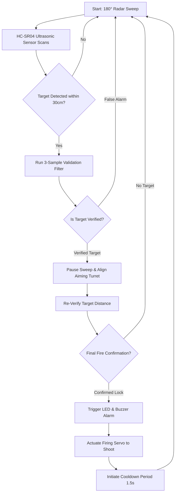

# ⚔️ Mini Air Defence System: Sky_Forge
### *Autonomous Civilian Protection and Aerial Threat Neutralization*

**Sky_Forge** is a cyber-physical defense system prototype designed to shield vulnerable civilian zones—such as schools, malls, hospitals, and municipal buildings—from low-altitude drone intrusions and unauthorized UAV activity. By utilizing real-time radar mapping and an automated "Sense-Think-Act" control loop, this system provides a cost-effective, localized safety canopy against close-range aerial threats.

---

## 🎬 Project Demonstration

▶️ **[Watch the demo video](Sky_forge%20working%20demo%20video.mp4)** (`Sky_forge working demo video.mp4` in this repository)

> [!NOTE]
> The demonstration video above showcases the system's complete operational cycle: **Autonomous Horizon Sweep ➔ Target Acquisition ➔ Multi-Sample Distance Validation ➔ Servo Alignment ➔ Automatic Neutralization**.

---

## 🏗️ System Architecture & Workflow

Sky_Forge operates using a closed-loop control system structured on three classic pillars of robotics:

### 🛰️ The Sense-Think-Act Mechanics

1. **Sense (Scanning & Ranging):**
   An **HC-SR04 Ultrasonic Sensor** is mounted on a sweeping radar platform (0° to 180° sweep). As it sweeps, it continuously monitors target distance at intervals of $9^\circ$.
2. **Think (Noise Filtering & Target Verification):**
   The Arduino Uno processes sensor pulses. To prevent false positives from wind, bugs, or electrical noise, the firmware uses a **2-of-3 voting filter** in `loop()`: it takes three readings at each angle (each one the average of two pings, from `readDistanceAvg`) and reports a target only when at least two of them are within range, using the mean of the two that agree.
3. **Monitor (Plan Position Indicator Radar):**
   Angle and verified distance details are piped over a Serial connection (`115200 baud`) to a host PC. A custom visualizer program renders a sweeping **Plan Position Indicator (PPI) radar** screen, overlaying active targets with a red alert vector.
4. **Act (Aiming & Neutralization):**
   When a target checks out as threat-positive within $30\text{ cm}$, the sweep halts. The platform aligns the **Aiming Servo** precisely to the target angle, performs a final validation check, sounds a **Buzzer Alarm + Status LED**, and fires the trigger actuator mechanism before entering a $1.5\text{ s}$ safety cooldown.

---

## 📂 Source Code Map

All primary system code is structured neatly inside the [Source Codes](Source%20Codes) directory:

* 📄 **[Sky_Forge_Logic.ino](Source%20Codes/Sky_Forge_Logic.ino)**:
  Embedded C++ firmware for the Arduino Uno. Manages the sweeping state machine, smooth servo transitions, triple-sample filtering algorithms, coordinate aiming, and the trigger sequence.
* 📄 **[Sky_Forge_Radar.pde](Source%20Codes/Sky_Forge_Radar.pde)**:
  Processing GUI sketch. Reads incoming serial coordinate strings (e.g., `scan a=90 d=15`) and renders a classic green phosphor radar visualization complete with coordinate grids, custom text status reports, and red target indicators.

---

## 🔌 Hardware & Software Specifications

### 🛠️ Hardware Bill of Materials (BOM)
* **Microcontroller**: Arduino Uno (Atmega328P core)
* **Ranging Sensor**: HC-SR04 Ultrasonic Transceiver (2cm to 400cm range)
* **Actuators**: 
  - `servoRadar` (pin D6) - Sweeps the sensor
  - `servoAim` (pin D5) - Aligns the shooter module
  - `servoTrigger` (pin D3) - Actuates the launcher firing link
* **Threat Indicators**: Active Piezo Buzzer & High-Brightness LED
* **Effector**: Spring-actuated mechanical neutralization launcher

### 📌 Arduino Uno Pinout Mapping
| Component | Pin Type | Arduino Pin | Description |
|-----------|----------|-------------|-------------|
| HC-SR04 Trig | Digital Output | D9 | Ultrasonic pulse trigger |
| HC-SR04 Echo | Digital Input | D10 | Ultrasonic echo receiver |
| Radar Servo | PWM Output | D6 | 0° to 180° horizon sweep |
| Aiming Servo | PWM Output | D5 | Turret angle alignment |
| Trigger Servo | PWM Output | D3 | Neutralization launcher actuation |
| Alert Buzzer | Digital Output | D2 | Threat detection audio alert |
| Threat LED | Digital Output | D12 | Visual target lock indicator |

### ▶️ Running It
1. Open `Source Codes/Sky_Forge_Logic.ino` in the Arduino IDE and upload it to the Uno.
2. Close the Arduino Serial Monitor (only one program can hold the port).
3. Open `Source Codes/Sky_Forge_Radar.pde` in Processing. Set `portName` to your Arduino's port
   (`COM11` by default; e.g. `/dev/ttyACM0` on Linux). If that port isn't found, the sketch prints the
   available ports and uses the first one. Both sides talk at `115200` baud.

### 🎛️ Tuning
The behaviour is set by constants at the top of `Sky_Forge_Logic.ino`:

| Constant | Default | What it does |
|----------|---------|--------------|
| `SCAN_STEP` | `9` | Degrees the radar servo moves per step (smaller = finer but slower sweep) |
| `DETECT_DISTANCE_CM` | `30` | A voted reading at or under this starts an engagement |
| `FIRE_DISTANCE_CM` | `30` | The confirming reading after aiming must be at or under this to fire |
| `MAX_DISTANCE_CM` | `30` | Readings beyond this count as "nothing there" (also the radar's range) |
| `AIM_ANGLE_OFFSET` | `0` | Added to the radar angle when aiming, to correct a misaligned launcher |
| `FIRE_REST_ANGLE` / `FIRE_SHOOT_ANGLE` | `80` / `15` | Trigger servo positions; tune them to your firing mechanism |
| `FIRE_HOLD_MS` | `300` | How long the trigger stays in the shoot position |
| `COOLDOWN_MS` | `1500` | Minimum time between shots (the first shot after power-up is never held back) |

### 💻 Software & Libraries Used
* **Microcontroller Compiler**: Arduino IDE v2+
* **Visualization Environment**: Processing 3+ (Serial Library)
* **Arduino Libraries**:
  - `Servo.h` (Built-in servo control)
* **Mathematical Verification**: 
  - MATLAB & Simulink models for trajectory validation and tracking logic.

---

## 🔮 Future Enhancements

* 👁️ **Computer Vision Integration**: Replace/augment the ultrasonic sensor with a micro-camera (e.g., ESP32-Cam) running YOLOv8-Nano to distinguish between friendly civilian targets (birds, balls) and hostile threats (drones).
* 📡 **IoT Web Dashboard**: Add an ESP8266/ESP32 interface to log threat alerts to a cloud database and notify security personnel.
* ⚡ **High-Speed Actuation**: Upgrade to high-torque metal-geared servo motors to minimize lock-on delay.

---

## 👥 Project Development Team
Developed with passion by the students of **B.Tech Artificial Intelligence (Class of 2025-29)**, *Amrita Vishwa Vidyapeetham, Coimbatore*:

* **A. Pardhav Reddy** (CB.AI.U4CPS25059)
* **Dhiren Vasudeva** (CB.AI.U4CPS25014)
* **Ch. Venkata Abhiram** (CB.AI.U4CPS25012)
* **Sai Jitesh C.K.** (CB.AI.U4QTS25016)
* **C. Sai Hardhik Reddy** (CB.AI.U4AID25112)
