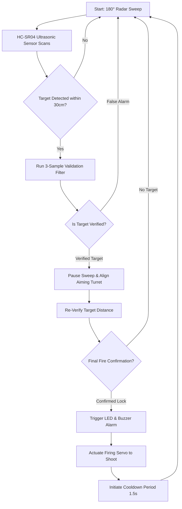

# ⚔️ Mini Air Defence System: Sky_Forge
### *Autonomous Civilian Protection and Aerial Threat Neutralization*

**Sky_Forge** is a cyber-physical defense system prototype designed to shield vulnerable civilian zones—such as schools, malls, hospitals, and municipal buildings—from low-altitude drone intrusions and unauthorized UAV activity. By utilizing real-time radar mapping and an automated "Sense-Think-Act" control loop, this system provides a cost-effective, localized safety canopy against close-range aerial threats.

---

## 🎬 Project Demonstration

https://github.com/user-attachments/assets/demo-video-placeholder

> [!NOTE]
> The demonstration video above showcases the system's complete operational cycle: **Autonomous Horizon Sweep ➔ Target Acquisition ➔ Multi-Sample Distance Validation ➔ Servo Alignment ➔ Automatic Neutralization**.

---

## 🏗️ System Architecture & Workflow

Sky_Forge operates using a closed-loop control system structured on three classic pillars of robotics:

### 🛰️ The Sense-Think-Act Mechanics

1. **Sense (Scanning & Ranging):**
   An **HC-SR04 Ultrasonic Sensor** is mounted on a sweeping radar platform (0° to 180° sweep). As it sweeps, it continuously monitors target distance at intervals of $9^\circ$.
2. **Think (Noise Filtering & Target Verification):**
   The Arduino Uno processes sensor pulses. To prevent false positives from wind, bugs, or electrical noise, the firmware uses a **triple-sample voting filter** (`readDistanceAvg`). It checks three sequential pulses and computes a moving average only if multiple readings confirm the target.
3. **Monitor (Plan Position Indicator Radar):**
   Angle and verified distance details are piped over a Serial connection (`115200 baud`) to a host PC. A custom visualizer program renders a sweeping **Plan Position Indicator (PPI) radar** screen, overlaying active targets with a red alert vector.
4. **Act (Aiming & Neutralization):**
   When a target checks out as threat-positive within $30\text{ cm}$, the sweep halts. The platform aligns the **Aiming Servo** precisely to the target angle, performs a final validation check, sounds a **Buzzer Alarm + Status LED**, and fires the trigger actuator mechanism before entering a $1.5\text{ s}$ safety cooldown.

---

## 📂 Source Code Map

All primary system code is structured neatly inside the [Source Codes](file:///c:/AIDS/GITHUB/Mini-Air-Defence-System-Sky_Forge-main/Source%20Codes) directory:

* 📄 **[Sky_Forge_Logic.ino](file:///c:/AIDS/GITHUB/Mini-Air-Defence-System-Sky_Forge-main/Source%20Codes/Sky_Forge_Logic.ino)**:
  Embedded C++ firmware for the Arduino Uno. Manages the sweeping state machine, smooth servo transitions, triple-sample filtering algorithms, coordinate aiming, and the trigger sequence.
* 📄 **[Sky_Forge_Radar.pde](file:///c:/AIDS/GITHUB/Mini-Air-Defence-System-Sky_Forge-main/Source%20Codes/Sky_Forge_Radar.pde)**:
  Processing GUI sketch. Reads incoming serial coordinate strings (e.g., `scan a=90 d=15`) and renders a classic green phosphor radar visualization complete with coordinate grids, custom text status reports, and red target indicators.

---

## 🔌 Hardware & Software Specifications

### 🛠️ Hardware Bill of Materials (BOM)
* **Microcontroller**: Arduino Uno (Atmega328P core)
* **Ranging Sensor**: HC-SR04 Ultrasonic Transceiver (2cm to 400cm range)
* **Actuators**: 
  - `servoRadar` (pin D6) - Sweeps the sensor
  - `servoAim` (pin D5) - Aligns the shooter module
  - `servoTrigger` (pin D3) - Actuates the launcher firing link
* **Threat Indicators**: Active Piezo Buzzer & High-Brightness LED
* **Effector**: Spring-actuated mechanical neutralization launcher

### 💻 Software & Libraries Used
* **Microcontroller Compiler**: Arduino IDE v2+
* **Visualization Environment**: Processing 3+ (Serial Library)
* **Arduino Libraries**:
  - `Servo.h` (Built-in servo control)
* **Mathematical Verification**: 
  - MATLAB & Simulink models for trajectory validation and tracking logic.

---

## 🔮 Future Enhancements

* 👁️ **Computer Vision Integration**: Replace/augment the ultrasonic sensor with a micro-camera (e.g., ESP32-Cam) running YOLOv8-Nano to distinguish between friendly civilian targets (birds, balls) and hostile threats (drones).
* 📡 **IoT Web Dashboard**: Add an ESP8266/ESP32 interface to log threat alerts to a cloud database and notify security personnel.
* ⚡ **High-Speed Actuation**: Upgrade to high-torque metal-geared servo motors to minimize lock-on delay.

---

## 👥 Project Development Team
Developed with passion by the students of **B.Tech Artificial Intelligence (Class of 2025-29)**, *Amrita Vishwa Vidyapeetham, Coimbatore*:

* **A. Pardhav Reddy** (CB.AI.U4CPS25059)
* **Dhiren Vasudeva** (CB.AI.U4CPS25014)
* **Ch. Venkata Abhiram** (CB.AI.U4CPS25012)
* **Sai Jitesh C.K.** (CB.AI.U4QTS25016)
* **C. Sai Hardhik Reddy** (CB.AI.U4AID25112)
